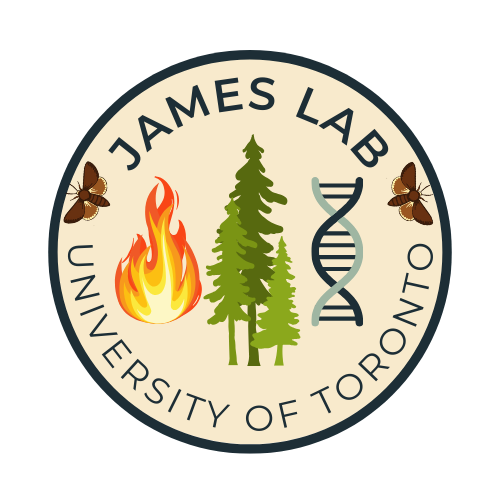

:::: {.columns}

::: {.column width="25%"}

:::

::: {.column width="10%"} 

:::

::: {.column width="65%"}
At present, the James Lab does not have funded graduate student or postdoctoral opportunities. Due to the large number of unsolicited inquiries we receive, we are unfortunately unable to respond individually to all prospective applicants.

That said, exceptional candidates whose research interests and experience align particularly closely with the lab’s research program may still be considered on a case-by-case basis, depending on qualifications, funding, and timing. Prospective applicants are encouraged to review our current research carefully before getting in touch.
:::

::::